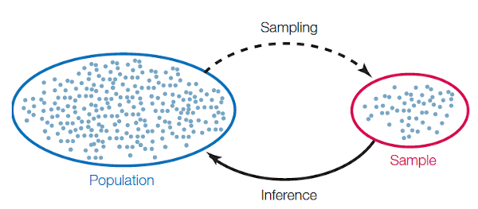
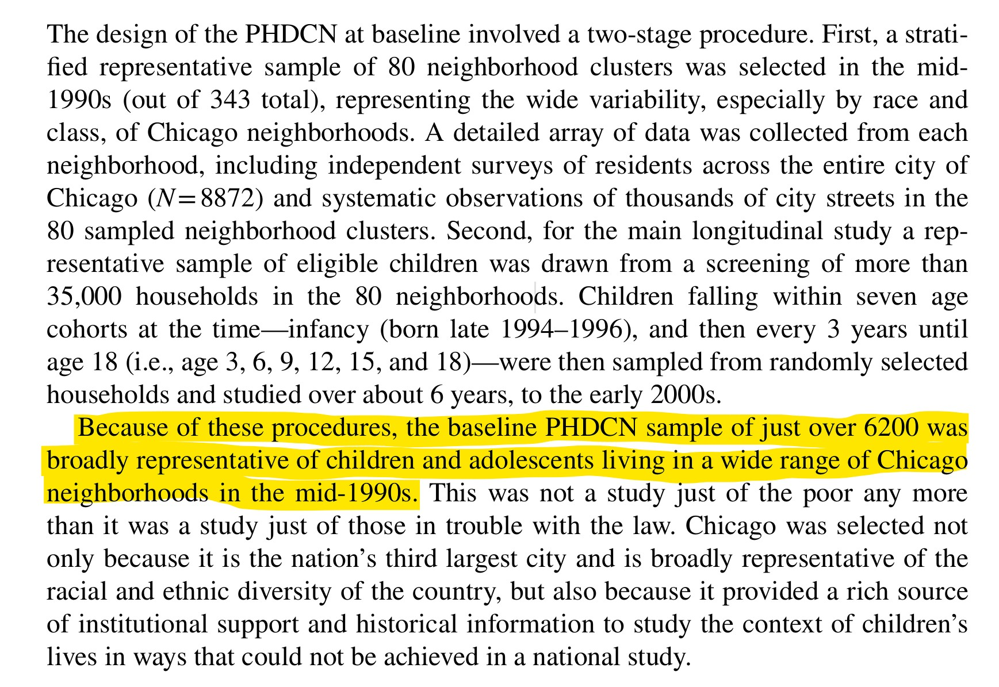
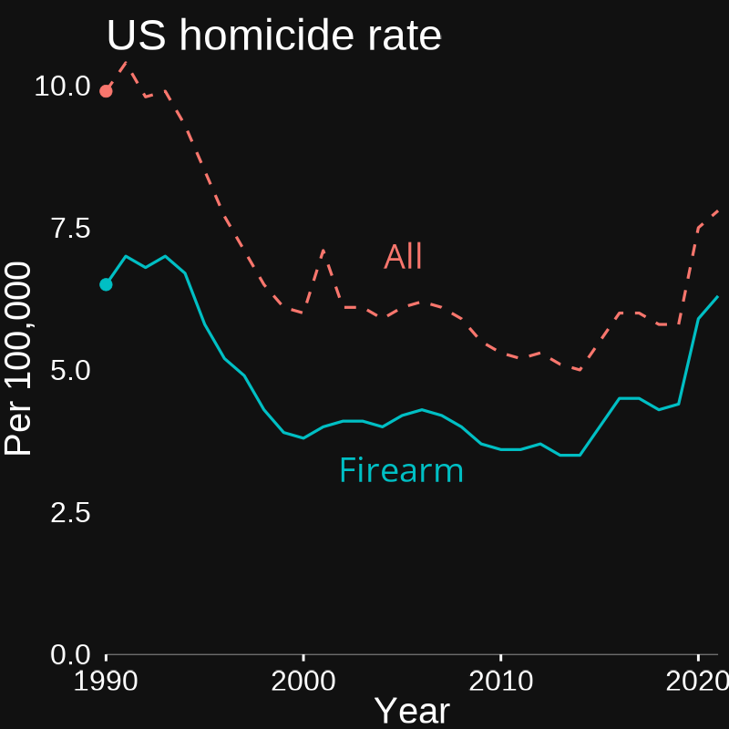
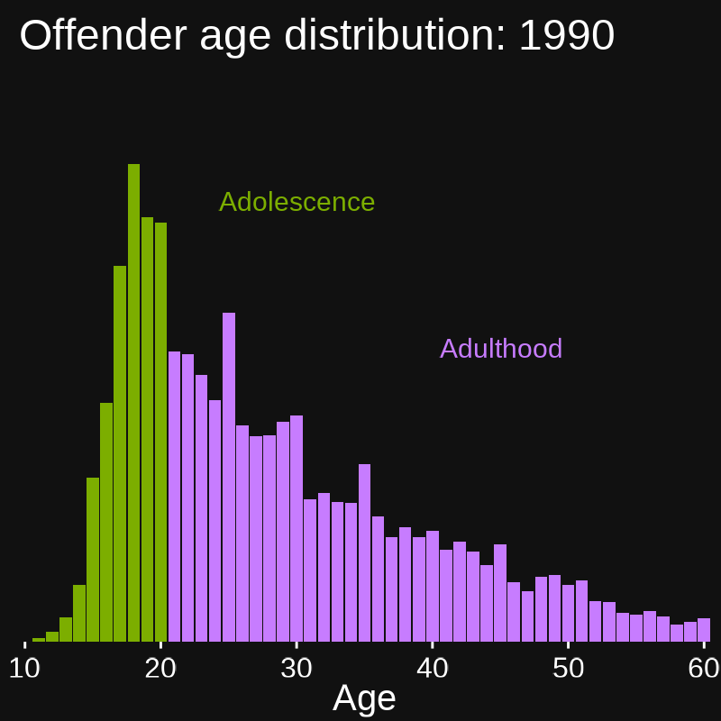
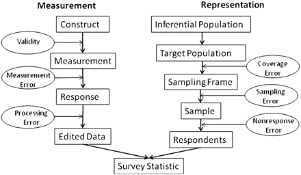
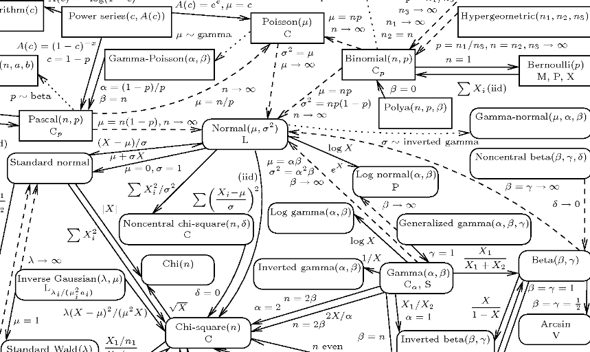
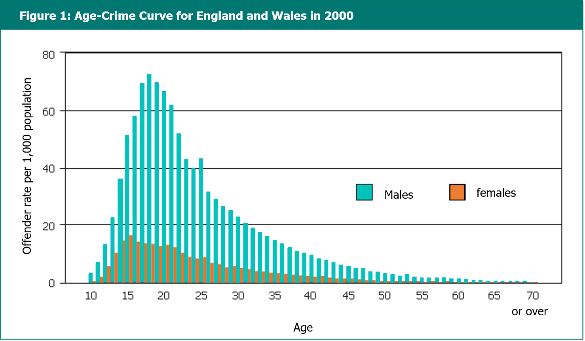
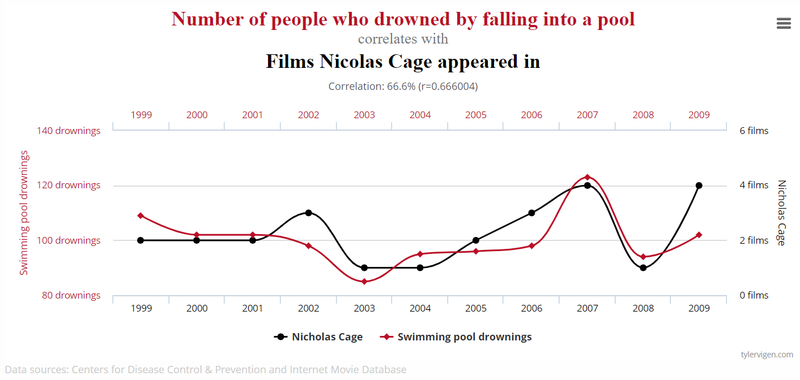

```{r, include=FALSE}
library(tidyverse)
library(janitor)
knitr::opts_chunk$set(echo=FALSE, message=FALSE, warning=FALSE, eval=TRUE, dev = "svg")
set.seed(7)
```


## Today

* Populations and Samples

* Crime Data

* Measurement

* Distributions

* Conditional Distributions


# Populations and samples

&nbsp;




## Terminology

**Population**: All members of some given set of interest

* Our goal is usually to learn something about this group

. . .

**Sample**: A subset of the population selected for study

. . .

**Sampling**: Process of selecting members of population into the sample

. . .

**Sampling frame**: Members of population eligible to be in your sample

. . .

**Observation**: One of the sampled units

. . .

**Variable**: A measure describing the observation(s)

. . .

&nbsp;

::: {.center}

*Your data will contain only observations and variables, but their value is determined by everything else*

:::


## Example: BCS

> To estimate the level of crime victimisation in the United Kingdom, the British Crime Survey surveys a random sample of 3,000 UK household residents per month and asks them about incidents of victimisation (e.g., burglary) in the past year.

. . .

**Population**: Everyone in the United Kingdom

. . .

**Sample**: 3000 household residents

. . .

**Sampling**: Random selection from all UK households

. . .

**Sampling frame**: People living in a known household

. . .

**Observation**: A person

. . .

**Variable**: Past year burglary victimisation

. . .

::: {.center}

*What would these data be bad for?*

:::


## Types of statistics

::::: {.columns}

:::: {.column}

### Descriptive

* Describing a sample
* Summarizing variables

::::

:::: {.column}


### Inferential

* Learning about the population
* Testing hypotheses

::::

:::::

. . .

To make **inferences** about populations using samples, your sample needs to be **representative** of your population—at least in the ways that matter

. . .

Samples are **representative** when they have a similar composition to the population along the characteristics you are interested in

. . .

&nbsp;

::: {.center}

*Next week we'll be talking about inferential statistics*

:::

## {.dark-slide}

{.nostretch style="width: 75%;"}

::: {.aside}

Source: [Sampson et al. (2022)](https://link.springer.com/article/10.1007/s40865-022-00203-0)

:::


## Crime data {.black-slide}

&nbsp;

:::: {.columns}

::: {.column}



:::

::: {.column}



:::

::::


## Police data

An example: `data.police.uk`

* All police-recorded crime in England, Wales, and Northern Ireland
   * A *population*!
   * Tens/hundreds of thousands of observations
   * Geolocation
   * Small area estimates possible

. . .

::::: {.columns}

:::: {.column}

**Advantages:**

* Captures wide array of offenses
* Often easily available
* Often *all* that is available

::::

:::: {.column}

::: {.fragment}

**Challenges:**

* Misses **unreported crime**
* *Reporting* varies widely
* Quality varies widely

:::

::::

:::::

## The Dark Figure of Crime

::::: {.columns}

:::: {.column width="60%"}

Not all crimes are *discovered*

* Victimless crimes
* Missing person homicides

::: {.fragment}

Not all crimes are *reported*

* Varies by place, individuals, crime type

:::

::: {.fragment}

Not all reported are *recorded* by police

* Different rules (e.g., hierarchy)
* Differential treatment
* Political incentives

:::

::::

:::: {.column width="40%"}

{.nostretch width="100%"}

::::

:::::


## An example

Observed Crime Rate = Actual Rate ∗ Probability of Reporting


> According to the U.C.R., the incidence of rape nearly doubled from 1973 to 1990. The N.C.V.S., by contrast, shows that it declined by around forty per cent during the same period. Researchers... found that the upward trend in the U.C.R. data correlated with upticks in the number of female police officers, and with the advent of rape crisis centers and reformed investigative styles. It could be, in short, that a modernized approach to the policing of rape drastically increased the frequency with which it was reported while reducing its incidence.

[Matthew Hutson. 2020. "The Trouble with Crime Statistics." The New Yorker](https://www.newyorker.com/culture/annals-of-inquiry/the-trouble-with-crime-statistics)

. . .

::: {.center}

*Note the complex process generating the data!*

:::


## Victimization data

An Example: **British Crime Survey**

* Self-reported victimisation
* Sample of 3,000 per month
   * Great for nationwide estimates
   * Bad for small area estimates

. . .

::::: {.columns}

:::: {.column}

**Advantages:**

* Captures unreported crime
* Can get at exposure and effects
   * *How many times*
   * *How badly injured*


::::

:::: {.column}

::: {.fragment}

**Challenges:**

* Reluctance to answer
* Hidden populations
* Expense
* Doesn't capture victimless crime

:::

::::

:::::


## Self-reported offense data


An Example: **PADS+**

* 716 youth in/around Peterborough
   * Representative sample at age 12
* Repeated follow-up—with incredible *retention*
* Detailed information on life and context

. . .

::::: {.columns}

:::: {.column}

**Advantages:**

* Captures unreported crime
* Captures crime without victim
* Can get at motivation


::::

:::: {.column}

::: {.fragment}

**Challenges:**

* Reluctance to answer
* Hidden populations
* Many crimes very rare
* Expense

:::

::::

:::::


## Ideal criminological data

*Ideal data would cover every potential crime and what occurred as a result*

. . .

::::: {.columns}

:::: {.column}

That is, for a given opportunity, was the crime...

::: {.incremental}

* Attempted?
* Successful?
* Discovered?
* Reported to police?

:::

::::

:::: {.column}


::: {.fragment .incremental}

And was the offender...<br><br>

* Seen or found?
* Informally sanctioned?
* Arrested?
* Incarcerated?

:::

::::

:::::

. . .

::: {.center}

*These are all important but nearly never all observed, especially not for a large number of incidents*

:::


## Types of studies

::: {.incremental}

* **Case study**: One unit observed once (perhaps over a period)
* **Cross-section**: Many units observed at one time point
* **Time series**: One unit observed at multiple times
* **Time-series cross-section**: 
   * Many units observed at different times
   * Not the same units at each time
* **Panel study**:

   * Many units observed at different times
   * Same units observed at each time

:::

. . .

&nbsp;

::: {.center}

*Each is useful for answering different questions*

:::


# Measurement

&nbsp;


## What is measurement?

&nbsp;


The *process* of connecting an abstract concept to empirical data

&nbsp;

. . .

Research questions must be testable with empirical data

&nbsp;


. . .

Testing thus relies heavily on measurement

&nbsp;

. . .

No research design can overcome bad measures


## Types of measures

&zwj;**Observables**: Objective, externally measurable variables

   * Individual height, occupation, stated beliefs, arrest history
   * Neighborhood population, geographical area, crime rate


*Observables can be directly seen and/or experienced*

. . .

**Unobservables**: Subjective, internal, or only indirectly measurable

   * Individual self-control, wellness, social class, actual beliefs
   * Neighborhood social capital, disadvantage, collective efficacy

*Unobservables do not exist in the real world: they are conceptual*

. . .

::: {.center}

*In Criminology, we're very often interested in unobservables.*

:::


## Measurement principles

&zwj;**Conceptualization**: *What is X?*

* Define what it constitutes and how it relates to other concepts
* Goal: Minimize ambiguity

. . .

&zwj;**Operationalization**: *How do I measure X?*

* Define observable(s)—**indicators**—that are related to the concept
* If single indicator, it is a **proxy** for the concept
   + e.g. *Years of School* is a proxy for *Education*
* If multiple indicators, they can be combined into *composite* measure

. . .

::: {.center}

*When reading articles, pay attention to how things are measured!*

:::


## Indicators and causes

::::: {.columns}

:::: {.column}

**Reflective**: *The value of the underlying unobservable variable is __reflected__ in the indicators*

```{tikz, fig.width = 3, cache = TRUE}
\usetikzlibrary{positioning}
\definecolor{black}{HTML}{000000}
\tikzset{
    > = stealth,
    every node/.append style = {
        draw = none,
        scale = 3
    },
    every path/.append style = {
        arrows = ->,
        draw = black,
        fill = none,
        scale = 1,
        line width = 1.5mm
    },
    hidden/.style = {
        draw = black,
        shape = circle,
        inner sep = 1pt
    }
}
\tikz{
    \node[hidden] (x) at (0,0) {$x$};
    \node (y1) at (-2,-4)  {$y_1$};
    \node (y2) at (0,-4)  {$y_2$};
    \node (y3) at (2,-4)  {$y_3$};

    \path (x) edge (y1);
    \path (x) edge (y2);
    \path (x) edge (y3);
  }
```


::::


:::: {.column}

::: {.fragment}

**Formative**: *The underlying unobservable variable is __formed__ by the combination of the indicators*

```{tikz, fig.width = 3, cache = TRUE}
\usetikzlibrary{positioning}
\definecolor{black}{HTML}{000000}
\tikzset{
    > = stealth,
    every node/.append style = {
        draw = none,
        scale = 3
    },
    every path/.append style = {
        arrows = ->,
        draw = black,
        fill = none,
        scale = 1,
        line width = 1.5mm
    },
    hidden/.style = {
        draw = black,
        shape = circle,
        inner sep = 1pt
    }
}
\tikz{
    \node[hidden] (x) at (0,0) {$y$};
    \node (y1) at (-2,-4)  {$x_1$};
    \node (y2) at (0,-4)  {$x_2$};
    \node (y3) at (2,-4)  {$x_3$};

    \path (y1) edge (x);
    \path (y2) edge (x);
    \path (y3) edge (x);
}
```


:::

::::

:::::

. . .

&nbsp;

::: {.center}

*These impact how we estimate measures—a topic for another time!*

*Let's see some examples*

:::


## Individual reflective: 

**Self-control**

Concept: The ability to delay gratification, tolerate frustration, and carefully consider before acting.

. . .

Indicators: *Would you agree, neither agree nor disagree, or disagree that you...*

   * "get upset when you have to wait for something?"
   * "act without stopping to think?"
   * "like to do daring things?"
   * "are impatient—want to have things right away?"
   * "are careful about what you do?"
   
. . .

Assumption: *Shared variation in the indicators represents self-control.*


## Individual formative

**Offending frequency scale**

Concept: A summary measure of frequency and severity of offending.

. . .

Indicators: *In the past year, how many times have you...*

   * "taken something that wasn't yours?"
   * "used force to take something from someone else?"
   * "punched, kicked, or pushed someone else?"
   * "attacked someone with a weapon like a knife or gun?"
   
. . .

Assumption: *This combination of different types of offending counts provides a useful measure of something.*


## Neighborhood reflective

### Child-centered informal social control

Concept: The shared neighborhood norms and expectations for intervening against child misbehavior.

. . .

Indicators: *How likely is it that people in your neighborhood would stop it if...*

   * "a group of neighborhood children were skipping school and hanging out on a street corner."
   * "some children were spray-painting graffiti on a local building."
   * "children were fighting out in the street."
   * "a child was showing disrespect to an adult."


. . .

Assumption: *Shared variation in the measures represents underlying expectations for social control of children.*


## Neighborhood formative

### Concentrated disadvantage

Concept: The spatial clustering of socioeconomic disadvantage.

. . .

&zwj;Indicators: *Census tract percentage of...*

   * "families below the poverty line."
   * "individuals on public assistance."
   * "individuals unemployed."
   * "female-headed households."
   * "individuals under age 18."
   
. . .

Assumption: *The combination of these measures provides a useful index of disadvantage.*


## Estimation is hard! {.dark-slide}

<br>

{.nostretch width="70%"}


::: {.aside}

Source: [Groves & Lyburg (2010) "Total Survey Error: Past, Present, and Future"](https://doi.org/10.1093/poq/nfq065)

:::


# Types of quantitative data

&nbsp;


## Continuous data

**Continuous** data take ordered, evenly-spaced, numeric values:

* The difference between 1cm and 2cm is the same as 5cm and 6cm
* The difference between 20C and 25C is the same as 25C and 30C

. . .

If they have a *true non-arbitrary zero*, they are **ratio** data

::: {.incremental}

* If something is 0cm long, it has *no length* (ratio!)
* If the temperature is 0C, there isn't *no temperature* (not ratio!)
   * The 0 is arbitrary: In Fahrenheit it is 32 degrees!
* Multiplication and division only work with ratio data
   * 15cm is half as long as 30cm
   * 15C is not half as hot as 30C
      * 15C = 59F = 288K; 30C = 86F = 303K

:::

## Discrete or count data

**Counts** are a special type of numeric data:

* True zero like ratio data
* Strictly non-negative
* Only whole (integer) values

. . .

Events or incidents are counts

* You can't have negative crimes or half a crime.

. . .

We get **rates** by dividing counts by **exposures** like population, time, or area

* **Exposures** measure what is "at risk" for an event
* e.g., Homicides per 100,000 people


## Ordinal data

**Ordinal** data can be ranked (ordered), but have no units or even intervals

. . .

::::: {.columns}

:::: {.column}

A common **Likert scale** item:

* Strongly Agree
* Agree
* Neither Agree nor Disagree
* Disagree
* Strongly Disagree

::::

:::: {.column}

::: {.fragment}

No clear intervals:

The difference between "strongly agree" and "disagree" and between "disagree" and "neither agree nor disagree" may not be the same

:::

::::

:::::
. . .

This means you cannot add/subtract or multiply/divide ordinal data

. . .

You also can't easily compare one person's ordinal value to another's

* There's no objective reference point


## Nominal (categorical) data

**Nominal** or **categorical** data can't even be ranked. Every value is *qualitatively*, rather than quantitatively, different:

* Gender, nationality, occupation

. . .

Sometimes we use nominal data to create other types:

* Occupation into ranked socio-economic status or prestige
* Nationality into high/middle/low income country

. . .

**Binary** or **dichotomous** data are a special case of nominal or ordinal data when there are only two categories

* e.g., alive or dead
* A useful mean can be calculated for binary data!


# Describing data

&nbsp;




## Central tendency

Measures of **central tendency** are ways to summarize a variable mathematically using a (usually) single number


::::: {.columns}

:::: {.column}

::: {.fragment fragment-index=1}

**Mean**

* The "average" or "expected value"
* Defined only for continuous data

:::

::: {.fragment fragment-index=3}

&nbsp;

**Mode**

* The most common single value
* Defined for all data (even continuous!)

:::

::::

:::: {.column}

::: {.fragment fragment-index=2}

**Median**

* The "middle" value or 50th **percentile**
* Defined for continuous or ordinal data

:::

::::

:::::


## Dispersion

Measures of **dispersion** summarize how spread out values are in a variable

. . .

We typically only define these for continuous data

. . .

**Standard Deviation**

* Roughly the average difference between data values and the mean
   * Low values indicate data are clustered around the mean
   * High values indicate data are spread away from the mean

. . .

**Variance**

* The square of the standard deviation
* Not typically interpretable
* Mainly useful in calculations


## Probability distributions

Mathematical functions that give the **probability** of observing each value

* This is just how likely it is for a variable to take any given value
* Common notation: $P(X)$ (probability of $X$)

. . .

**Empirical distributions** or **sample distributions** 

* The set of all observed values of a variable

. . .

**Theoretical distributions**

* Imagined or expected frequencies based on mathematical parameters
* We often compare empirical distributions to theoretical ones

. . .

::: {.center}

*We'll focus on empirical ones today and talk about theoretical ones next week*

:::


## Categorical

Because they take a limited number of values, we typically summarize categorical data by the count or proportion of each value

. . .


::: {style="font-size: 0.7em;"}

```{r}
shoot <- tibble(`Type of Crime` = sample(c("Robbery", "Assault", "Theft"), 250, replace=TRUE, prob = c(0.1, 0.3, 0.6)))
shoot %>% 
  count(`Type of Crime`, name = "Frequency") %>% 
  mutate(`Proportion` = round(`Frequency`/sum(`Frequency`), 2)) %>%
knitr::kable()
```

:::

. . .

Bar plots are a good way to visualize categorical distributions

```{r, fig.height = 2.75, fig.width = 6}
ggplot(shoot, aes(x = `Type of Crime`)) + 
  geom_bar(fill = "#003C71") + 
  theme_minimal(base_size = 14) + 
  labs(y = "Frequency") + 
  annotate("text", x = "Theft", y = 30, label = "Mode", color = "#64A70B", size = 8) + 
  theme(panel.grid.major.x = element_blank(),  
        panel.grid.major.y = element_line(color = "#28282B", linewidth = 0.25),
        panel.background = element_rect(fill="#ECEEF1", color="#ECEEF1"), 
        plot.background = element_rect(fill="#ECEEF1", color="#ECEEF1") )
```


## Ordinal

Ordinals can be summarized similarly to categoricals, but they have a median—where the cumulative proportion (percentile) passes 0.50.

::: {style="font-size: 0.7em;"}

```{r}
fear <- tibble(`Fear of Crime` = 
                 ordered(c(rep("Very High", 50), 
                   rep("High", 60), 
                   rep("Moderate", 75), 
                   rep("Low", 100), 
                   rep("Very Low", 25)), levels = c("Very Low", "Low", "Moderate", "High", "Very High")))
fear %>% 
  count(`Fear of Crime`, name = "Frequency") %>% 
  mutate(`Proportion` = round(`Frequency`/sum(`Frequency`), 2),
         `Cumulative Proportion` = cumsum(`Proportion`)) %>%
knitr::kable()
```

:::

. . .

```{r, fig.height = 2.75, fig.width = 6}
ggplot(fear, aes(x = `Fear of Crime`)) + 
  geom_bar(fill = "#003C71") + 
  theme_minimal(base_size = 14) + 
  labs(y = "Frequency") + 
  annotate("text", x = "Low", y = 20, label = "Mode", color = "#64A70B", size = 6) +
  annotate("text", x = "Moderate", y = 20, label = "Median", color = "#64A70B", size = 6) +
  theme(panel.grid.major.x = element_blank(),  
        panel.grid.major.y = element_line(color = "#28282B", linewidth = 0.25),
        panel.background = element_rect(fill="#ECEEF1", color="#ECEEF1"), 
        plot.background = element_rect(fill="#ECEEF1", color="#ECEEF1") )
```


## Continuous

Continuous data can take a limitless number of values, so we summarize them with measures of central tendency and dispersion.

::: {style="font-size: 0.7em;"}

```{r}
robbery <- tibble(`Crime Rate` = 100000*(rnbinom(400, 1,  0.15) / rnbinom(400, 100, mu = 4000)))

robbery %>%
  summarize(`Mean`   = mean(`Crime Rate`), 
            `Median` = median(`Crime Rate`),
            `Mode` = density(`Crime Rate`)$x[which.max(density(`Crime Rate`)$y)],
            `Std. Dev.` = sd(`Crime Rate`),
            N = n()) %>%
  mutate(across(everything(), ~round(.,2))) %>%
  knitr::kable()
```

:::

. . .

&nbsp;

We visualize continuous distributions with **histograms** and **density plots**

:::: {.columns}

::: {.column}

```{r, fig.height = 4.75}
robbery %>% 
  ggplot(aes(x = `Crime Rate`)) + 
  geom_histogram(binwidth = 50, fill = "#003C71") +
  labs(y = "Frequency", title = "Histogram of Crime Rate") +
  theme_minimal(base_size = 18) +
  theme(panel.grid.major.x = element_blank(),  
        panel.grid.major.y = element_line(color = "#28282B", linewidth = 0.25),
        panel.background = element_rect(fill="#ECEEF1", color="#ECEEF1"), 
        plot.background = element_rect(fill="#ECEEF1", color="#ECEEF1") )
```

:::

::: {.column}

```{r, fig.height = 4.75}
robb_density <- density(robbery$`Crime Rate`)

robbery %>% 
  ggplot(aes(x = `Crime Rate`)) + 
  geom_density(fill = "#28282B", alpha = 0.2) + 
  geom_vline(xintercept = robb_density$x[which.max(robb_density$y)], color = "#003C71", size = 1) +
  geom_vline(xintercept = median(robbery$`Crime Rate`), color = "#8A1538", size = 1) +
  geom_vline(xintercept = mean(robbery$`Crime Rate`), size = 1, color = "#64A70B") + 
  geom_text(data = tibble(
             x = c(
               robb_density$x[which.max(robb_density$y)],
                 median(robbery$`Crime Rate`),
                 mean(robbery$`Crime Rate`)) - 20,
             y = c(0.001, 0.001, 0.001),
             label = c("Mode", "Median", "Mean"),
             color = c("Mode", "Median", "Mean")),
           aes(x = x, y = y, label = label, color = color), size = 5,
           angle = 90) +
  annotate("errorbar",
           xmin = mean(robbery$`Crime Rate`), 
           xmax = mean(robbery$`Crime Rate`) + sd(robbery$`Crime Rate`), 
           width = 0.0005, 
           y = 0.002) +
  annotate("text", x = mean(robbery$`Crime Rate`) + 0.5*sd(robbery$`Crime Rate`),
           label = "Std. Dev.", y = 0.00215, size = 4.5) +
  scale_color_manual(values = c("Mode" = "#003C71", "Median" = "#8A1538", "Mean" = "#64A70B")) +
  labs(y = "Probability Density", title = "Density Plot of Crime Rate") +
  theme_minimal(base_size = 18) + 
  theme(panel.grid.major.x = element_blank(),  
        panel.grid.major.y = element_line(color = "#28282B", linewidth = 0.25),
        panel.background = element_rect(fill="#ECEEF1", color="#ECEEF1"), 
        plot.background = element_rect(fill="#ECEEF1", color="#ECEEF1"),
        legend.position = "none")
  
```

:::

::::

## Visualise your data

These all have the same mean, median, and standard deviation!

::: {style="font-size: 0.7em;"}

```{r}

dists <-
  tibble(
  Normal = rnorm(100000, mean = 1, sd = 1),
  Poisson = rpois(100000, 1),
  Uniform = runif(100000, -0.75, 2.75)
  ) %>% pivot_longer(everything())

dists %>%
  group_by(name) %>%
  summarize(Mean = mean(value), Median = median(value), `Std. Dev.` = sd(value)) %>%
  mutate(across(-name, ~format(., nsmall = 1, digits = 2))) %>%
  knitr::kable(col.names = c("Distribution", "Mean", "Median", "Std. Dev"))

```

:::

```{r, fig.height = 3}
dists %>%
  ggplot(aes(x = value)) + 
  facet_wrap(~name) + 
  geom_density(fill = "#28282B", alpha = 0.2) + 
  theme_minimal(base_size = 16) + 
  geom_vline(data = dists %>% 
               group_by(name) %>% 
               summarize(Mean = mean(value)), 
             aes(xintercept = Mean), color  = "#64A70B", size = 1) +
  geom_errorbarh(aes(xmin = Mean, xmax = Mean + stddev, y = 0.6),
                 data = 
                   dists %>%
                   group_by(name) %>% 
                   summarize(Mean = mean(value), stddev = sd(value)),
                 height = 0.05, inherit.aes = FALSE) +
  xlim(-3, 5) +
  theme(panel.grid.major.x = element_blank(),  
        panel.grid.major.y = element_line(color = "#28282B", linewidth = 0.25),
        panel.background = element_rect(fill="#ECEEF1", color="#ECEEF1"), 
        plot.background = element_rect(fill="#ECEEF1", color="#ECEEF1"),
        legend.position = "none",
        axis.text.y = element_blank()) +
  labs(x = NULL, y = NULL)

```


# Quantitative relationships

&nbsp;




## Types of relationships

::: {style="font-size: 0.8em;"}

**Association**: *X and Y tend to "go together"*

* e.g., ice cream sales and violent crime rise at same time
* *May* imply common causes, e.g. temperature
* *Does not* imply banning ice cream will reduce crime or vice versa
* Purely observational—makes no assumptions

:::

. . .

::: {style="font-size: 0.8em;"}

**Effect**: *X causes Y*

* e.g., clearing a vacant lot reduces nearby violence 
* Implies *direction* and *cause*:
   * Clearing more lots will reduce violence there
   * Reducing violence will not clear lots
* Requires strong assumptions to **identify**

:::

. . .

::: {.center}

*For now, we'll focus on associations*

:::


## Distributions

Associations are really about **conditional probabilities**

* Probability $Y$ takes a particular value when $X$ takes a particular value
   * Notation: $P(Y|X)$ is "Probability of Y given X"
* e.g., if a suspect is white, their probability of arrest is 0.3.
   * $P(arrest|white) = 0.3$

. . .

A **conditional distribution** is the distribution a variable takes when a different variable takes some particular value

. . .

A **joint distribution** is the conditional distribution of each variable at every value of the other variable

. . .

::: {.center}

*These are hard to think about but intuitive in action*

:::


## Cross-tabs

The simplest joint distributions are those between categorical variables, usually displayed as **cross-tabulations**

::::: {.columns}

:::: {.column}

::: {style="font-size: 0.8em;"}

```{r}
sex_offense <- 
  tibble(Sex = c(rep("Male", 50), rep("Female", 20)),
         Offense = c(rep("Violent", 28), rep("Non-Violent", 22),
                     rep("Violent", 7), rep("Non-Violent", 13)))
tabyl(sex_offense, Sex, Offense) %>% 
  knitr::kable()
```

:::

::::

:::: {.column}

::: {style="font-size: 0.8em;"}

```{r}
tabyl(sex_offense, Sex, Offense) %>% 
  adorn_percentages() %>% 
  knitr::kable()
```

:::

::::

:::::

. . .

We can also visualise them with a bar plot

```{r, fig.height = 2.5}
sex_offense %>% ggplot(aes(x=Sex, group = Offense, fill = Offense)) + geom_bar() + theme_minimal(base_size = 14) + labs(y = "Frequency") + 
  theme(legend.position = c(0.15, 0.8),
        panel.grid.major.x = element_blank(),  
        panel.grid.major.y = element_line(color = "#28282B", linewidth = 0.25),
        panel.background = element_rect(fill="#ECEEF1", color="#ECEEF1"), 
        plot.background = element_rect(fill="#ECEEF1", color="#ECEEF1"),
        legend.background = element_rect(fill="#ECEEF1", color="#ECEEF1"))
```


## Categorical x continuous

If our association is between a categorical and a continuous variable, we can calculate statistics within each category

::: {style="font-size: 0.8em;"}

```{r}
rural <- tibble(Area = rep(c("Rural", "Urban"), each = 5000),
                `Pop Density` = c(rnorm(5000, 10, 2),
                                  rnorm(5000, 20, 3)),
                `Crime Rate` = (rpois(10000, `Pop Density`)^2) * 5000 / 100000) %>%
  sample_n(250)
rural %>% group_by(Area) %>% summarize(`Mean Crime Rate` = round(mean(`Crime Rate`), 2), 
                                       `Std. Dev.` = round(sd(`Crime Rate`),2 ),
                                       N = n()) %>%
  knitr::kable()
```

:::

. . .

Or draw a histogram or density for each category

:::: {.columns}

::: {.column}

```{r, fig.height = 4}
rural %>% 
  ggplot(aes(x = `Crime Rate`, group = Area, fill = Area, color = Area)) + 
  geom_histogram(alpha = 0.3, bins = 20, position = "identity") + 
  theme_minimal(base_size = 16) + 
  labs(y = "Frequency") + 
  theme(legend.position = c(0.8, 0.8),
        panel.grid.major.x = element_blank(),  
        panel.grid.major.y = element_line(color = "#28282B", linewidth = 0.25),
        panel.background = element_rect(fill="#ECEEF1", color="#ECEEF1"), 
        plot.background = element_rect(fill="#ECEEF1", color="#ECEEF1"),
        legend.background = element_rect(fill="#ECEEF1", color="#ECEEF1"))
```

:::

::: {.column}

```{r, fig.height = 4}
rural %>% 
  ggplot(aes(x = `Crime Rate`, group = Area, fill = Area, color = Area)) + 
  geom_density(alpha = 0.5) + 
  theme_minimal(base_size = 16) + 
  labs(y = "Density") + 
  theme(legend.position = c(0.8, 0.8),
        panel.grid.major.x = element_blank(),  
        panel.grid.major.y = element_line(color = "#28282B", linewidth = 0.25),
        panel.background = element_rect(fill="#ECEEF1", color="#ECEEF1"), 
        plot.background = element_rect(fill="#ECEEF1", color="#ECEEF1"),
        legend.background = element_rect(fill="#ECEEF1", color="#ECEEF1"))
```

:::

::::


## Continuous x continuous

When both variables are continuous, we usually measure association with a **correlation** and visualise with a **scatterplot**

```{r}
data.frame(`Crime Rate` = round(cor(rural$`Pop Density`, rural$`Crime Rate`), 2), row.names = "Pop. Density") %>%
  knitr::kable(col.names = "Crime Rate")
```


. . .

```{r, fig.height = 3}
rural %>%
  ggplot(aes(x = `Pop Density`, y = `Crime Rate`)) + 
  geom_point(alpha = 0.5) +
  xlab("Population Density") +
  geom_smooth(method = "lm", se = FALSE) +
  theme_minimal(base_size = 16) +
  theme(panel.grid.major.x = element_blank(),  
        panel.grid.major.y = element_line(color = "#28282B", linewidth = 0.25),
        panel.background = element_rect(fill="#ECEEF1", color="#ECEEF1"), 
        plot.background = element_rect(fill="#ECEEF1", color="#ECEEF1"))
```

Here I've added a **regression line** to illustrate the correlation


## Going Further

We can go pretty far just visualising results!

```{r, fig.height = 3}
rural %>%
  ggplot(aes(x = `Pop Density`, y = `Crime Rate`, color = Area, group = Area)) + 
  geom_point(alpha = 0.5) +
  geom_smooth(method = "lm", se = FALSE) +
  theme_minimal(base_size = 16) + 
  theme(legend.position = c(0.1, 0.8),
        panel.grid.major.x = element_blank(),  
        panel.grid.major.y = element_line(color = "#28282B", linewidth = 0.25),
        panel.background = element_rect(fill="#ECEEF1", color="#ECEEF1"), 
        plot.background = element_rect(fill="#ECEEF1", color="#ECEEF1"),
        legend.background = element_rect(fill="#ECEEF1", color="#ECEEF1"))
```

. . .

Soon we'll get into statistical models to measure and test relationships

. . .

But they're pretty much all just based on cross-tabs, group means, or correlations


## What does this show? {.dark-slide}

&nbsp;


## Correlation cautions {background-color="white"}

&nbsp;


<br>

::: {.center}

*He **will** kill again*

:::


## Anscombe's Quartet

Visualisation is important—these all have the same correlation (0.82)!

```{r, fig.height = 5, echo=FALSE, warning=FALSE, message=FALSE}
library(datasauRus)
anscombe %>%
  mutate(id = row_number()) %>%
  pivot_longer(x1:y4, names_to = c("var", "set"), names_pattern = "(x|y)(.$)") %>%
  pivot_wider(names_from = var, values_from = value) %>%
  ggplot(aes(x = x, y = y)) + 
  geom_point() + 
  facet_wrap(~set) + 
  geom_smooth(method = "lm", se = FALSE) + 
  theme_void() + 
  theme(strip.text = element_blank(),
        panel.background = element_rect(fill="#ECEEF1", color="#ECEEF1"), 
        plot.background = element_rect(fill="#ECEEF1", color="#ECEEF1"))
```


## Dinosaur deceit

So do these! Their $X$ and $Y$ values also have the same *means* and *standard deviations*!

```{r, fig.height = 5, echo=FALSE, warning=FALSE, message=FALSE}
datasaurus_dozen  %>%
  filter(dataset != "slant_down") %>%
  ggplot(aes(x = x, y = y)) + 
  geom_point() + 
  facet_wrap(~dataset) + 
  geom_smooth(method = "lm", se = FALSE) + 
  theme_void() + 
  theme(strip.text = element_blank(),
        panel.background = element_rect(fill="#ECEEF1", color="#ECEEF1"), 
        plot.background = element_rect(fill="#ECEEF1", color="#ECEEF1"))
```


## Wrap-up {.dark-slide}

* Takeaways

   * Measurement is complicated but important
   * Quantitative analysis is mainly about distributions
   * **Always visualise your data!**

* We'll pick up with more on relationships next week, and use that to lead into statistical inference